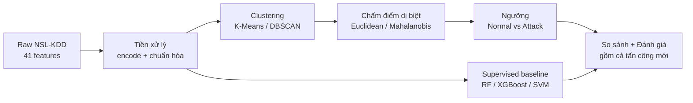

# 01 — Phân tích đề tài: Network Intrusion & Cyber Attack Detection

> Mục đích tài liệu: trả lời ba câu hỏi trước khi viết bất kỳ dòng code nào —
> **(1) đề tài này là gì, (2) mình phải làm gì, (3) dữ liệu trông như thế nào.**
> Mọi con số dưới đây được sinh từ dữ liệu thật bằng `scripts/profile_data.py`.

---

## 1. Tóm tắt nhanh

- **Đề tài**: xây dựng hệ thống **phát hiện xâm nhập mạng** (Network Intrusion Detection) theo hướng **phát hiện dị biệt** (anomaly detection) — tức là học cái "bình thường" rồi báo cái "bất thường", thay vì chỉ khớp với danh sách tấn công đã biết.
- **Dữ liệu**: bộ **NSL-KDD** (phiên bản làm sạch của KDD Cup 99), gồm 41 đặc trưng cho mỗi kết nối mạng.
- **Việc phải làm** (lấy từ `TOPIC.md`):
  1. Tiền xử lý traffic mạng (encode giao thức, chuẩn hóa thống kê gói tin).
  2. Kết hợp **clustering** (K-Means/DBSCAN) với **độ đo khoảng cách** (Mahalanobis/Euclidean) để cô lập các kết nối bất thường.
  3. **So sánh** mô hình phát hiện dị biệt **không giám sát** với mô hình **có giám sát**.
  4. **Đánh giá** khả năng phát hiện **tấn công mới** (novel attack signatures).

---

## 2. Đề tài là gì và vì sao quan trọng?

### 2.1. Hệ thống phát hiện xâm nhập (IDS)

Mạng máy tính giống như một tòa nhà có rất nhiều cửa. **IDS (Intrusion Detection System)** là hệ thống "camera + bảo vệ" theo dõi các kết nối đi qua và báo động khi thấy hành vi đáng ngờ.

Có hai cách phát hiện chính:

| Cách tiếp cận | Ý tưởng | Ưu điểm | Nhược điểm |
|---|---|---|---|
| **Signature-based** (dựa trên mẫu) | Ghi nhớ "dấu vân tay" của tấn công đã biết rồi so khớp | Chính xác với tấn công đã biết | **Mù** với tấn công mới (zero-day) |
| **Anomaly-based** (dựa trên dị biệt) | Học phân phối "bình thường" rồi báo cái lệch khỏi bình thường | Bắt được **tấn công mới** | Có thể báo nhầm (false positive) |

Đề tài của nhóm đi theo hướng thứ hai: **phát hiện dị biệt**. Đây cũng chính là lý do phương pháp **không giám sát** (unsupervised) được đề cao — nó không cần biết trước tấn công trông như thế nào.

### 2.2. Một kết nối mạng được mô tả thế nào?

Mỗi dòng dữ liệu là **một kết nối mạng** (một phiên giữa nguồn và đích), được tóm tắt bằng **41 con số/biến**. Ví dụ: kết nối kéo dài bao lâu, gửi bao nhiêu byte, dùng giao thức gì, tỉ lệ lỗi, số lần đăng nhập thất bại, có root shell không, tần suất kết nối tới cùng host trong 2 giây gần nhất…

Từ 41 biến đó, bài toán là trả lời: **kết nối này bình thường hay là tấn công?**

---

## 3. Bài toán và mục tiêu

### 3.1. Input / Output

- **Input**: một vector 41 đặc trưng của một kết nối.
- **Output**: nhãn dự đoán.

### 3.2. Hai cách đặt bài toán

| Kiểu bài toán | Nhãn | Khi nào dùng |
|---|---|---|
| **Nhị phân** (binary) | `normal` vs `attack` | Câu hỏi đơn giản: "có bị tấn công hay không?" |
| **Đa lớp** (multi-class) | `Normal`, `DoS`, `Probe`, `R2L`, `U2R` | Cần biết **họ** tấn công để xử lý phù hợp |

> Ghi chú: dữ liệu gốc có **tên tấn công cụ thể** (neptune, satan, guess_passwd…). Ta thường gộp chúng thành **5 nhóm** như bảng trên, hoặc chỉ Normal/Attack cho bài toán nhị phân.

### 3.3. Bốn mục tiêu kỹ thuật (lấy nguyên văn từ `TOPIC.md`)



1. **Preprocess** — biến dữ liệu thô thành dạng số sạch để mô hình dùng được.
2. **Clustering + distance** — tìm cấu trúc cụm của "bình thường" và đo độ xa của điểm mới.
3. **Unsupervised vs supervised** — cùng một bài toán, hai cách học, so sánh công bằng.
4. **Novel attack detection** — đo xem cách nào bắt được tấn công **chưa từng thấy khi train**.

---

## 4. Kiến thức nền (giải thích dễ hiểu)

### 4.1. Clustering — "gom nhóm những thứ giống nhau"

Clustering là **học không giám sát**: không có nhãn đúng sai, chỉ có dữ liệu, và ta muốn máy tự gom các điểm giống nhau lại.

**K-Means** — chia dữ liệu thành `k` cụm tròn, mỗi cụm có một **tâm (centroid)**:
- Máy lặp: gán mỗi điểm về tâm gần nhất → cập nhật tâm = trung bình các điểm trong cụm.
- **Dị biệt** = điểm có khoảng cách tới tâm gần nhất **quá lớn**.
- Ưu: nhanh, đơn giản. Nhược: phải chọn `k` trước, giả định cụm hình cầu.

**DBSCAN** — gom nhóm theo **mật độ**:
- Vùng nào có nhiều điểm sát nhau (≥ `minPts` trong bán kính `eps`) thì thành cụm.
- Điểm **không thuộc cụm nào** bị gắn nhãn **nhiễu (noise)**.
- **Điểm nhiễu chính là ứng viên dị biệt** — rất hợp với bài toán của mình.
- Ưu: không cần biết số cụm, tìm được cụm hình dạng bất kỳ. Nhược: nhạy với `eps`/`minPts`, khó khi dữ liệu nhiều chiều.

### 4.2. Độ đo khoảng cách — "đo độ lạ như thế nào?"

**Euclidean** — khoảng cách đường thẳng quen thuộc:

```
d(x, y) = sqrt( Σ (x_i - y_i)² )
```

- Coi mọi chiều **độc lập và quan trọng như nhau**.
- Rất **nhạy với thang đo**: một đặc trưng có giá trị hàng triệu sẽ lấn át đặc trưng 0–1 → **bắt buộc chuẩn hóa** trước.

**Mahalanobis** — khoảng cách "biết suy nghĩ":

```
d(x, μ) = sqrt( (x - μ)ᵀ · Σ⁻¹ · (x - μ) )
```

trong đó `μ` là vector trung bình, `Σ` là **ma trận hiệp phương sai** (covariance).

- Tính đến **phương sai** (chiều nào biến động mạnh) và **tương quan** (hai chiều có xu hướng đi cùng nhau).
- Vì sao hợp dữ liệu mạng: nhiều đặc trưng traffic **tương quan mạnh** (ví dụ `count` và `srv_count`, các `*_rate`). Mahalanobis "khử" sự trùng lặp đó, nên điểm lệch theo hướng bất thường thật sẽ bị phạt nặng hơn.
- Lưu ý thực tế: `Σ` có thể **suy biến** (do feature hằng hoặc đa cộng tuyến) → cần bỏ feature hằng và dùng **pseudo-inverse** hoặc thêm **regularization**.

> So sánh trực quan: Euclidean hỏi *"điểm này cách tâm bao xa theo đường chim bay?"*; Mahalanobis hỏi *"điểm này lệch bao nhiêu **so với mức biến động bình thường** của từng chiều và tương quan giữa chúng?"*. Cái sau công bằng hơn.

### 4.3. Unsupervised vs Supervised

| Tiêu chí | **Unsupervised** (không giám sát) | **Supervised** (có giám sát) |
|---|---|---|
| Dữ liệu train | Chỉ cần traffic, thường **chỉ Normal** | Cần nhãn `normal`/`attack` (và họ tấn công) |
| Cách học | Học phân phối/cấu trúc của bình thường | Học ranh giới phân loại từ nhãn |
| Bắt tấn công mới | **Tốt hơn** (không phụ thuộc mẫu đã biết) | Kém hơn (chỉ biết cái đã thấy) |
| Độ chính xác trên tấn công đã biết | Thường thấp hơn | **Cao hơn** |
| Báo nhầm | Dễ cao hơn, cần tinh chỉnh ngưỡng | Thường thấp hơn |

Bài toán của mình **so sánh hai hướng này** trên cùng dữ liệu, đặc biệt ở khả năng bắt **novel attack**.

---

## 5. Dữ liệu NSL-KDD

### 5.1. Nguồn gốc

- Xuất phát từ **KDD Cup 1999** — bộ dữ liệu phát hiện xâm nhập kinh điển.
- **NSL-KDD** là bản **làm sạch**: loại bỏ các bản ghi trùng lặp và cân bằng lại, khắc phục một số thiên lệch nổi tiếng của KDD'99.
- Link đề bài: <https://www.kaggle.com/datasets/hassan06/nslkdd>
  (script `scripts/download_data.py` tải từ mirror GitHub công khai cùng đúng bộ file, vì Kaggle cần đăng nhập).

### 5.2. Cấu trúc file

Mỗi dòng có **43 giá trị** phân tách bằng dấu phẩy:

```
41 đặc trưng  +  label (tên kết nối/tấn công)  +  difficulty (điểm khó)
```

- `label`: nhãn thật, ví dụ `normal`, `neptune`, `satan`, `guess_passwd`…
- `difficulty`: điểm khó của mẫu — **không dùng làm đặc trưng**, phải **drop** khi huấn luyện.

### 5.3. Bốn nhóm đặc trưng (41 biến)

| Nhóm | Số biến | Ý nghĩa | Ví dụ |
|---|---|---|---|
| **Basic** | 9 | Thông tin cơ bản của kết nối | `duration`, `protocol_type`, `service`, `flag`, `src_bytes`, `dst_bytes` |
| **Content** | 13 | Nội dung phiên (dấu hiệu tấn công logic) | `num_failed_logins`, `logged_in`, `root_shell`, `num_file_creations` |
| **Time-based traffic** | 9 | Thống kê trong cửa sổ thời gian ngắn (2 giây) | `count`, `srv_count`, `serror_rate`, `same_srv_rate` |
| **Host-based traffic** | 10 | Thống kê theo host đích | `dst_host_count`, `dst_host_srv_count`, `dst_host_*_rate` |

### 5.4. Biến phân loại (categorical)

| Biến | Số giá trị (train) | Ví dụ |
|---|---|---|
| `protocol_type` | 3 | `tcp`, `udp`, `icmp` |
| `service` | 70 | `http`, `ftp`, `smtp`, `domain_u`… |
| `flag` | 11 | `SF`, `S0`, `REJ`, `RSTO`… |

→ Cần **encode** (one-hot hoặc label encoding) trước khi đưa vào mô hình số.

### 5.5. Thống kê thật của dữ liệu

**Kích thước**

| Tập | Số dòng | Số cột |
|---|---|---|
| Train (`KDDTrain+.txt`) | **125.973** | 43 |
| Test (`KDDTest+.txt`) | **22.544** | 43 |

**Tỉ lệ Normal / Attack**

| Tập | Normal | Attack |
|---|---|---|
| Train | 67.343 (**53,5%**) | 58.630 (46,5%) |
| Test | 9.711 (**43,1%**) | 12.833 (56,9%) |

**Phân bố theo họ tấn công**

| Họ | Train | Test |
|---|---|---|
| Normal | 67.343 | 9.711 |
| DoS | 45.927 | 7.460 |
| Probe | 11.656 | 2.421 |
| R2L | 995 | 2.885 |
| U2R | **52** | 67 |

> Nhìn cột Train: DoS chiếm gần như toàn bộ phần tấn công, còn **R2L và U2R cực hiếm**. Đây là **mất cân bằng lớp** điển hình — mô hình rất dễ "bỏ qua" hai họ hiếm này.

**Tấn công mới (novel) trong test**

- Train có **22 loại** tấn công; test có **37 loại**.
- **17 loại chỉ xuất hiện ở test** (chưa từng thấy khi train):
  `apache2, httptunnel, mailbomb, mscan, named, processtable, ps, saint, sendmail, snmpgetattack, snmpguess, sqlattack, udpstorm, worm, xlock, xsnoop, xterm`

> **Đây là điểm cốt lõi của đề tài.** Test set *đã tự nhiên* chứa tấn công mà mô hình chưa từng học → có sẵn "phòng thí nghiệm" để đo khả năng phát hiện **signature mới**. Không cần tự chia tách phức tạp, chỉ cần đánh giá đúng.

### 5.6. Vài đặc điểm dữ liệu cần biết trước

- **Không có dòng trùng lặp** trong cả train và test (NSL-KDD đã khử) — yên tâm hơn KDD'99.
- **`num_outbound_cmds` là hằng số** (chỉ toàn 0) → nên **loại bỏ** vì không mang thông tin, còn làm hỏng ma trận hiệp phương sai của Mahalanobis.
- **Không có giá trị categorical lạ** trong test: mọi `protocol_type`/`service`/`flag` của test đều đã xuất hiện ở train. Tuy vậy vẫn nên thiết kế encode theo hướng "an toàn" (dùng `handle_unknown`) để không vỡ nếu đổi dữ liệu.
- `service` có cardinality cao (70 giá trị) → one-hot sẽ tạo ~70 cột thưa; cân nhắc giữa one-hot và label/target encoding.

---

## 6. Đề bài yêu cầu gì → việc cần làm cụ thể

| Yêu cầu trong `TOPIC.md` | Việc cần làm | Lưu ý |
|---|---|---|
| **Preprocess** traffic (encode protocol, normalize stats) | One-hot/label encode 3 biến categorical; chuẩn hóa (StandardScaler/MinMax) các biến số; drop `difficulty`, drop feature hằng | **Fit scaler chỉ trên train**, tránh rò rỉ dữ liệu |
| **Clustering** DBSCAN/K-Means | Huấn luyện trên phần "bình thường"; phân tích số cụm (elbow/silhouette), chọn `eps`/`minPts` cho DBSCAN | K-Means cần chọn `k`; DBSCAN coi noise là dị biệt |
| **Distance metrics** Mahalanobis/Euclidean | Tính khoảng cách tới tâm/phân phối; so sánh hai độ đo | Mahalanobis cần bỏ feature hằng + xử lý `Σ` suy biến |
| **Isolate anomalous connections** | Chuyển khoảng cách thành **điểm dị biệt**, đặt **ngưỡng** → nhãn Normal/Attack | Ngưỡng ảnh hưởng trực tiếp precision/recall |
| **Compare unsupervised vs supervised** | Chạy song song: unsupervised (cluster/distance) vs supervised (RF/XGBoost/SVM/LogReg) | Cùng tập train/test, cùng metric để công bằng |
| **Evaluate on novel attack signatures** | Đo riêng trên 17 loại novel: recall theo họ/từng loại; so với tấn công đã biết | Đây là kết quả "đắt" nhất của báo cáo |

---

## 7. Thách thức và lưu ý

1. **Mất cân bằng lớp nặng** — U2R chỉ 52 mẫu ở train. Accuracy sẽ đánh lừa; cần P**recision/Recall/F1/PR-AUC** và **recall theo từng họ**.
2. **Novel attack** — đừng đánh giá gộp; phải **tách riêng** nhóm đã biết vs nhóm mới để thấy rõ mô hình nào "tổng quát" hơn.
3. **Rò rỉ dữ liệu (leakage)** — chuẩn hóa/encode phải **fit trên train**, chỉ **transform** trên test.
4. **Mahalanobis dễ vỡ số** — drop feature hằng, cân nhắc regularization/pseudo-inverse.
5. **Cardinality cao của `service`** — one-hot làm dữ liệu thưa; có thể ảnh hưởng khoảng cách (nhất là Euclidean).
6. **Chọn ngưỡng dị biệt** — không có ngưỡng "đúng" tuyệt đối; nên báo cáo theo nhiều ngưỡng hoặc dùng đường cong PR.
7. **Tính tái lập** — cố định `random_state`, ghi lại cấu hình thí nghiệm.

---

## 8. Phạm vi và câu hỏi mở

Tài liệu này **chưa** chốt:
- Dùng bài toán nhị phân hay đa lớp làm trục chính (có thể làm cả hai).
- Chọn thuật toán/`k`/`eps`/`minPts`/ngưỡng cuối cùng.
- Có dùng thêm baseline dị biệt khác (Isolation Forest, LOF) hay không.
- Cách trình bày kết quả novel attack: theo họ hay theo từng loại tấn công.

→ Những điểm này sẽ được quyết trong **tài liệu 02 — Thiết kế kỹ thuật**.

### Câu hỏi mở cần cân nhắc
- Khi huấn luyện unsupervised, có nên **chỉ dùng Normal** (đúng tinh thần anomaly) hay dùng toàn bộ train?
- Với supervised, có nên **loại bớt một số họ tấn công khỏi train** để mô phỏng "chưa biết" một cách công bằng hơn không?
- Ngưỡng dị biệt nên chọn theo **percentile** trên tập normal hay theo **chi-square** (với Mahalanobis)?

---

## 9. Glossary — thuật ngữ nhanh

| Thuật ngữ | Nghĩa dễ hiểu |
|---|---|
| **IDS** | Intrusion Detection System — hệ thống phát hiện xâm nhập |
| **Anomaly** | Dị biệt, điểm bất thường |
| **Novel attack** | Tấn công mới, chưa từng thấy khi huấn luyện |
| **Zero-day** | Lỗ hổng/tấn công chưa được công bố, chưa có bản vá |
| **Clustering** | Phân cụm — gom các điểm giống nhau |
| **Centroid** | Tâm cụm (trung bình các điểm trong cụm) |
| **DBSCAN** | Thuật toán phân cụm theo mật độ; điểm lẻ = nhiễu |
| **Noise point** | Điểm nhiễu — không thuộc cụm nào, ứng viên dị biệt |
| **Euclidean** | Khoảng cách đường thẳng |
| **Mahalanobis** | Khoảng cách có tính phương sai và tương quan giữa các chiều |
| **Covariance matrix** | Ma trận hiệp phương sai — mô tả biến động và tương quan |
| **Supervised** | Học có giám sát — dùng nhãn đúng/sai |
| **Unsupervised** | Học không giám sát — không dùng nhãn |
| **Feature** | Đặc trưng (một biến đầu vào) |
| **One-hot encoding** | Biến categorical thành nhiều cột 0/1 |
| **Standardization** | Chuẩn hóa về trung bình 0, độ lệch chuẩn 1 |
| **Class imbalance** | Mất cân bằng lớp (một lớp quá ít so với lớp khác) |
| **Precision** | Trong các ca báo "tấn công", bao nhiêu % đúng |
| **Recall** | Trong các ca tấn công thật, bắt được bao nhiêu % |
| **F1-score** | Trung bình điều hòa của Precision và Recall |
| **ROC-AUC / PR-AUC** | Chỉ số đánh giá mô hình trên nhiều ngưỡng (PR-AUC hợp dữ liệu lệch) |
| **False positive** | Báo nhầm (bình thường → tấn công) |
| **False negative** | Bỏ sót (tấn công → bình thường) |

---

## 10. Tài liệu tham khảo

- NSL-KDD dataset: <https://www.kaggle.com/datasets/hassan06/nslkdd>
- M. Tavallaee et al., *A Detailed Analysis of the KDD CUP 99 Data Set*, 2009 (mô tả NSL-KDD).
- Scikit-learn docs — clustering, `DBSCAN`, `KMeans`, `DistanceMetric`:
  <https://scikit-learn.org/stable/modules/clustering.html>
